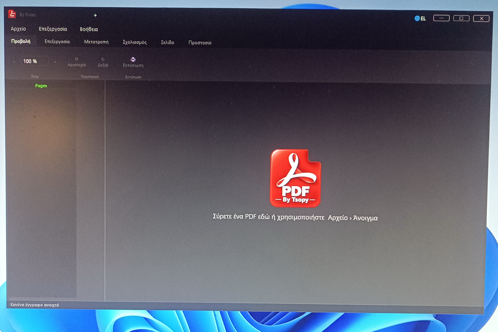

# PDF-Tsopy — Free PDF Editor for Windows

   
  <h1>PDF-Tsopy</h1>
  
<b>Δωρεάν, τοπικός επεξεργαστής PDF για Windows — χωρίς cloud, χωρίς συνδρομή.</b>

  
  
  
  
  🌐 <a href="https://tsopy274-coder.github.io/PDF-Tsopy/">Ιστοσελίδα</a> · 
  ⬇️ <a href="https://github.com/tsopy274-coder/PDF-Tsopy/releases/latest">Λήψη</a> · 
  📋 <a href="CHANGELOG.md">Changelog</a> · 
  🇬🇧 <a href="#-english">English</a>

https://tsopy274-coder.github.io/PDF-Tsopy/

---

## 🇬🇧 English

### What is PDF-Tsopy?

**PDF-Tsopy** is a free desktop PDF editor for Windows, designed to make working with PDF documents simple, powerful and accessible.

Built with Python, PyQt6 and PyMuPDF, it combines essential PDF editing, conversion, OCR, annotation and document management tools in one application.

No cloud uploads. No subscription. Your documents stay on your computer.

### ✨ Key Features

| Category | Features |
|---|---|
| PDF Viewer | Open, zoom, rotate, search and print |
| PDF Editing | Edit text, images and watermarks |
| OCR | Extract text from scanned documents |
| Conversion | PDF to Office, images, text and Markdown |
| Office Conversion | OCR to Word and Excel |
| Annotations | Highlight, underline, strikethrough and notes |
| Page Management | Merge, split, insert, reverse, crop and resize |
| Security | Password encryption and decryption |
| Compression | Reduce PDF file size |
| Digital Workflow | Add signatures |
| Scanning | WIA and Canon IJ Scan Utility |
| Printing | Duplex, color and page-range options |
| Multi-document | Work with multiple PDF tabs |
| Languages | Greek, English, French and German |

### 🖥️ Screenshots

  
   <em>Main application interface</em>

  
   <em>PDF tools and editing</em>

  
   <em>Document management</em>

### 🔒 Privacy First

PDF-Tsopy is designed for local document processing.

- Your PDF files are processed on your computer.
- No cloud upload is required.
- No telemetry is included, according to the project configuration.
- Optional Internet blocking.

Your documents remain under your control.

### 💻 System Requirements

- Windows 10 or Windows 11
- 64-bit operating system
- Internet connection only when required for optional services or installation procedures.

### 🛠️ Built With

- Python
- PyQt6
- PyMuPDF
- Pillow
- PyInstaller
- Inno Setup

### 🌍 Languages

PDF-Tsopy supports:

- 🇬🇷 Greek
- 🇬🇧 English
- 🇫🇷 French
- 🇩🇪 German

### 📜 License

PDF-Tsopy is distributed under the **GNU General Public License v3.0 (GPL-3.0)**.

See [LICENSE](LICENSE) for details.

### ⭐ Support the Project

If you find PDF-Tsopy useful:

- ⭐ Star this repository.
- Share it with friends and colleagues.
- Report bugs through GitHub Issues.
- Suggest new features.

Every star and suggestion helps the project grow!

### 📥 Download & Installation

1. Visit the [Latest Releases](https://github.com/tsopy274-coder/PDF-Tsopy/releases/latest) page.
2. Download the latest Windows installer.
3. **To receive your installation password, send an email to [tsopy274@gmail.com](mailto:tsopy274@gmail.com).**
4. Run the installer and enter the password provided to you.

---

## 🇬🇷 Ελληνικά

### Τι είναι το PDF-Tsopy;

Το **PDF-Tsopy** είναι ένα δωρεάν πρόγραμμα επεξεργασίας PDF για Windows, σχεδιασμένο για εύκολη, γρήγορη και ολοκληρωμένη διαχείριση εγγράφων PDF.

Δημιουργήθηκε με Python, PyQt6 και PyMuPDF και συγκεντρώνει εργαλεία επεξεργασίας, μετατροπής, OCR, σχολιασμού και προστασίας εγγράφων σε μία εφαρμογή.

**Χωρίς συνδρομές. Χωρίς υποχρεωτικό cloud. Τα αρχεία σου παραμένουν στον υπολογιστή σου.**

### ✨ Βασικές λειτουργίες

- Άνοιγμα, προβολή, περιστροφή και αναζήτηση PDF.
- Επεξεργασία κειμένου και εικόνων.
- Προσθήκη υδατογραφήματος και υπογραφής.
- OCR για αναγνώριση κειμένου από σαρωμένα έγγραφα.
- Μετατροπή PDF σε Word, Excel, εικόνες, κείμενο και Markdown.
- Συγχώνευση και διαχωρισμός PDF.
- Εισαγωγή, περικοπή και αλλαγή μεγέθους σελίδων.
- Σχολιασμός, επισήμανση και υπογράμμιση.
- Κρυπτογράφηση και προστασία με κωδικό.
- Συμπίεση PDF.
- Σάρωση μέσω WIA και Canon IJ Scan Utility.
- Εκτύπωση με επιλογές διπλής όψης και χρώματος.
- Ταυτόχρονη εργασία με πολλαπλά έγγραφα.

### 🌍 Διαθέσιμες γλώσσες

Ελληνικά, Αγγλικά, Γαλλικά και Γερμανικά.

### 📥 Λήψη

[Κατέβασε την τελευταία έκδοση του PDF-Tsopy](https://github.com/tsopy274-coder/PDF-Tsopy/releases/latest).

### ⭐ Υποστήριξη

Αν σου αρέσει το PDF-Tsopy, κάνε Star στο GitHub και βοήθησε να γίνει γνωστό σε περισσότερους χρήστες!

### 📥 Λήψη και Εγκατάσταση

1. Επισκέψου τη σελίδα [Τελευταίων Εκδόσεων](https://github.com/tsopy274-coder/PDF-Tsopy/releases/latest).
2. Κατέβασε τον τελευταίο εγκαταστάτη για Windows.
3. **Για να λάβεις τον κωδικό εγκατάστασης, στείλε μήνυμα στο [tsopy274@gmail.com](mailto:tsopy274@gmail.com?subject=PDF-Tsopy%20-%20%CE%9A%CF%89%CE%B4%CE%B9%CE%BA%CF%8C%CF%82%20%CE%95%CE%B3%CE%BA%CE%B1%CF%84%CE%AC%CF%83%CF%84%CE%B1%CF%83%CE%B7%CF%82).**
4. Εκτέλεσε την εγκατάσταση και πληκτρολόγησε τον κωδικό που θα λάβεις.
---

  **PDF-Tsopy**
   
  Developed by Haris Tsopy
   
  <a href="https://github.com/tsopy274-coder">GitHub</a> ·
  <a href="https://tsopy274-coder.github.io/PDF-Tsopy/">Official Website</a>

