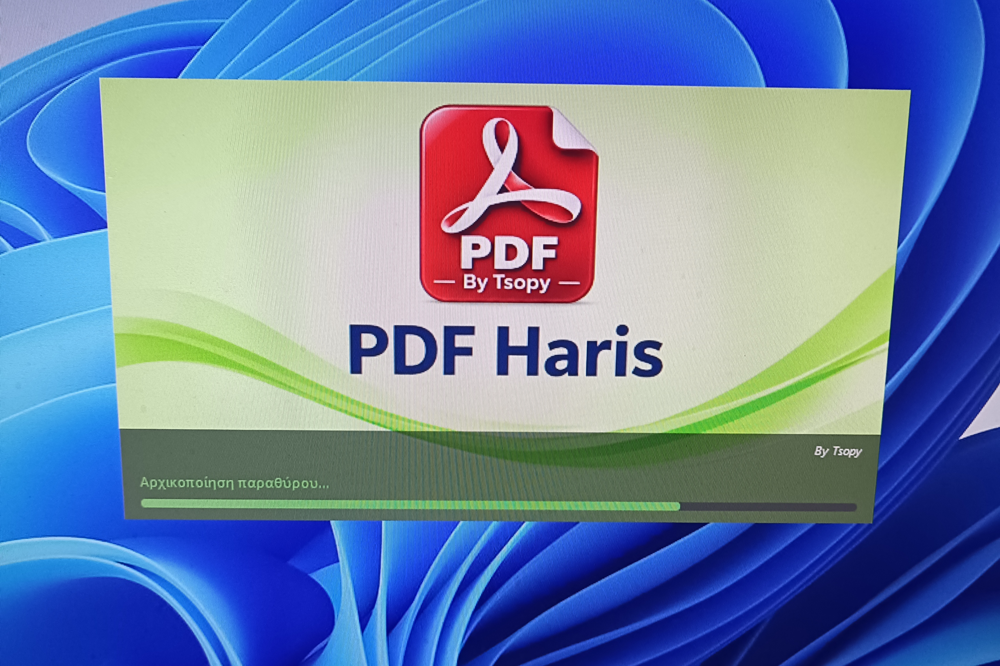

<div align="center">
  
  <h1>PDF-Tsopy</h1>
  <p><b>Δωρεάν, τοπικός επεξεργαστής PDF για Windows — χωρίς cloud, χωρίς συνδρομή.</b></p>

  [](https://www.gnu.org/licenses/gpl-3.0)
  [](https://github.com/tsopy274-coder/PDF-Tsopy/releases/latest)
  [](https://github.com/tsopy274-coder/PDF-Tsopy)
  
  🌐 <a href="https://tsopy274-coder.github.io/PDF-Tsopy/">Ιστοσελίδα</a> · 
  ⬇️ <a href="https://github.com/tsopy274-coder/PDF-Tsopy/releases/latest">Λήψη</a> · 
  📋 <a href="CHANGELOG.md">Changelog</a> · 
  🇬🇧 <a href="#-english">English</a>
</div>

---

## 📖 Περιεχόμενα
- [Τι είναι](#-τι-είναι)
- [Χαρακτηριστικά](#-χαρακτηριστικά)
- [Στιγμιότυπα](#-στιγμιότυπα)
- [Εγκατάσταση](#-εγκατάσταση)
- [Ιδιωτικότητα](#-ιδιωτικότητα)
- [Τεχνολογίες](#️-τεχνολογίες)
- [Συχνές Ερωτήσεις](#-συχνές-ερωτήσεις)
- [Υποστήριξη](#-υποστήριξη)
- [Άδεια](#-άδεια)

---
### 📸 Στιγμιότυπα / Screenshots

<div align="center">
  
  <br><br>
  
  
</div>

---


## 🎯 Τι είναι
Το **PDF-Tsopy** είναι ένας δωρεάν επεξεργαστής PDF για Windows, γραμμένος σε Python (PyQt6 + PyMuPDF). Ανοίγει, επεξεργάζεται, μετατρέπει, σχολιάζει, προστατεύει και εκτυπώνει PDF αρχεία — όλα **τοπικά** στον υπολογιστή σας, χωρίς αποστολή δεδομένων σε cloud.

## ✨ Χαρακτηριστικά

| Κατηγορία | Δυνατότητες |
|---|---|
| **Προβολή** | Άνοιγμα PDF, zoom, περιστροφή, αναζήτηση, εκτύπωση |
| **Επεξεργασία** | Κείμενο, εικόνες, υδατογράφημα, συμπίεση, OCR, υπογραφή |
| **Μετατροπή** | PDF ↔ Office / Εικόνα / Κείμενο / Markdown, OCR → Word/Excel, μαζική επεξεργασία |
| **Σχολιασμός** | Επισήμανση, διαγραφή, υπογράμμιση, σημειώσεις |
| **Σελίδες** | Εισαγωγή, διαίρεση, συγχώνευση, αντιστροφή, περικοπή, αλλαγή μεγέθους |
| **Προστασία** | Κρυπτογράφηση / αποκρυπτογράφηση με κωδικό |
| **Σάρωση** | Υποστήριξη WIA και Canon IJ Scan Utility |
| **Εκτύπωση** | Πλήρης διάλογος με duplex, χρώμα, σελίδες |
| **Πολλαπλά έγγραφα** | Καρτέλες για ταυτόχρονη εργασία |
| **Γλώσσες** | Ελληνικά, Αγγλικά, Γαλλικά, Γερμανικά |

## 📸 Στιγμιότυπα
*(Πρόσθεσε εδώ 2–4 εικόνες από την εφαρμογή)*

```markdown


---
<br>

<div align="center">
  <h2 id="-english">🇬🇧 English</h2>
  <p><b>Free, local PDF editor for Windows — no cloud, no subscription.</b></p>
</div>

**PDF-Tsopy** is a free, local PDF editor for Windows, written in Python (PyQt6 + PyMuPDF).

🌐 **Website:** [tsopy274-coder.github.io/PDF-Tsopy](https://tsopy274-coder.github.io/PDF-Tsopy/)

### ✨ Features
- **View** — open, zoom, rotate, search, print
- **Edit** — text, images, watermark, compression, OCR, signature
- **Convert** — PDF ↔ Office / Image / Text / Markdown, OCR → Word/Excel, batch processing
- **Annotate** — highlight, strikethrough, underline, notes
- **Pages** — insert, split, merge, reverse, crop, resize
- **Protect** — encrypt / decrypt with password
- **Scan** — WIA and Canon IJ Scan Utility support
- **Print** — full dialog with duplex, color, page range
- **Multi-document** — tabs for simultaneous work
- **Languages** — Greek, English, French, German

### 🔒 Privacy
All files are processed locally. No cloud upload, no telemetry. Optional Internet blocking.

### 🛠️ Technologies
Python · PyQt6 · PyMuPDF · Pillow · PyInstaller · Inno Setup

### 📦 Installation
1. Download the installer from [Releases](https://github.com/tsopy274-coder/PDF-Tsopy/releases/latest).
2. Run `HarisPDF-Setup-x.y.exe` (e.g., `HarisPDF-Setup-1.4.exe`).
3. Enter the installation password (available for free via email — see Support).

**Requirements:** Windows 10 / 11 (64-bit)

**Verification:** Each release includes a SHA256 checksum in the release notes.
